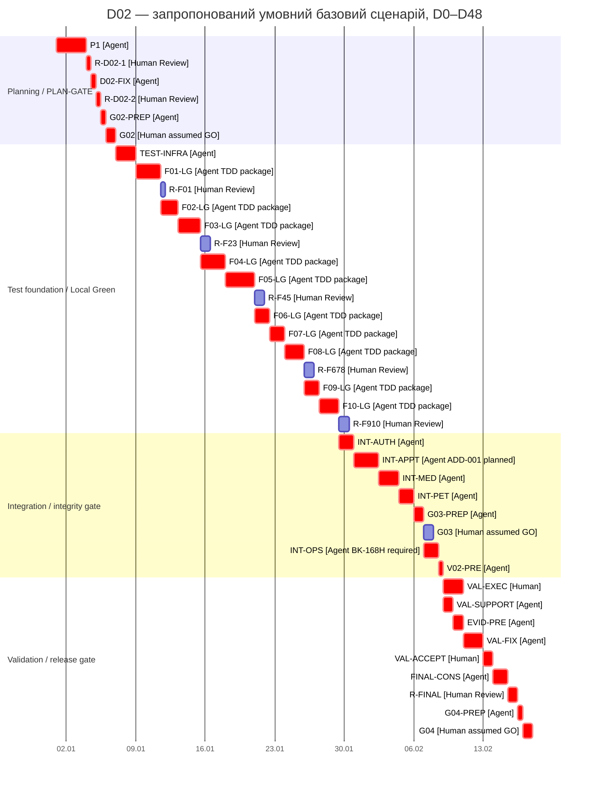

# План реалізації інформаційної системи «Ветеринарна клініка»

## 1. Статус документа

Пакет D02 у commit `b1a6cd8608ad59f6bce5dc7c835e0178b6881a81` отримав Human `APPROVE` у [коментарі D02 #19](https://github.com/yanchiix/vet-clinic/issues/19#issuecomment-6250515670) від 18.10.2026 16:31:54 +03:00; Issue #19 закрито як completed о 16:32:00 +03:00.

Незалежний технічний аудит G02 на цій вершині рекомендував `REVISE` до усунення неоднозначності обліку TDD/D01 і зафіксував чотири додаткові уточнення. Рекомендація аудитора не є рішенням Human у G02. Поточна післяаудитна редакція плану є чернеткою для повторного Human Review; вона не відкриває D02 повторно й не змінює його GitHub-статус.

Human approval D02 не означає автоматичного рішення G02: GO. Рішення G02, G03 і G04 приймає лише Human у відповідних Gate.

Workflow тікетів:

`Todo → In Progress → Review → Done`

Результат виконання переходить у Review. Human приймає його або повертає на доопрацювання.

## 2. Scope і нормативна основа

План охоплює погоджені 25 тікетів:

- S01, A01, G01;
- T01–T04;
- F01–F10;
- D01–D02;
- V01–V02;
- VAL01;
- G02–G04.

Нормативна основа:

- затверджена SRS v0.1;
- затверджений ADD-001;
- чинні REQ, AC і BDD без зміни їхніх ID або змісту;
- OPEN-003 та OPEN-006;
- DEP-001–005;
- повні актуальні описи GitHub Issues #1–#25;
- критерії етапу планування реалізації щодо плану, Gantt, критичного шляху, людських дій і ризиків;
- актуальна `docs/planning/traceability.md` із цього самого пакета у робочому дереві, базованому на HEAD `b1a6cd8608ad59f6bce5dc7c835e0178b6881a81`;
- commit `10e051b0bc945a56e69a16b5539860d1014c13a6` є історичною точкою створення першої версії `implementation-plan.md` і `risk-register.md` та десяти погоджених доповнень G03 у матриці, але не подається як актуальний HEAD або стан поточного робочого дерева.

Повна матриця REQ → AC → BDD → Ticket ID міститься в `docs/planning/traceability.md` і тут не дублюється.

План не вводить нових функцій. Методики тестування та verification позначаються окремо і не трактуються як нові вимоги до поведінки системи.

## 3. Ресурсна модель

Для базового розрахункового сценарію прийнято:

- один Agent;
- Agent одночасно виконує лише одну активну Agent-роботу;
- умовна місткість Agent — до 6 годин на відносний робочий день;
- окремий Human resource;
- умовна місткість Human — до 3 годин на відносний робочий день;
- людські трудовитрати подаються в годинах;
- календарні дати й фактична персональна доступність не визначаються;
- `TEST-INFRA` є окремою Agent-роботою після умовного G02: GO і до першого `Fxx-LG`; вона створює test runner, конфігурацію, зафіксовані залежності, спільні fixtures і перевірений локальний test command;
- `Fxx-LG` є оціненим TDD-пакетом до локального Green, а не лише написанням production-коду: пакет включає підготовку тестів, очікуваний Red, реалізацію, Green, можливий refactoring із повторним Green і поточний запис D01;
- INT-робота включає інтеграційний прогін, виправлення та повторний прогін у межах оцінки, а також поточне оновлення D01/V01; вона не повторює локальні тести як окремий effort;
- локальний Green може розблокувати наступну роботу до повного Done попереднього Issue;
- Human Review, G02, G03, VAL01 і G04 є окремими роботами;
- 37,5 години Human охоплюють показані Review, Gate і validation разом із коротким записом відповідного рішення; підготовка рішень DEP, зовнішня координація й очікування до цієї суми не входять;
- базовий сценарій припускає своєчасну готовність DEP-001–005;
- базовий сценарій припускає умовні рішення GO у G02, G03 і G04;
- ці рішення використовуються лише для розрахунку наступної гілки;
- фактичні Human Gate decisions ще не прийняті;
- за фактичного REVISE графік підлягає перерахунку;
- додаткові цикли виправлень після REVISE не включено до фіксованої тривалості.

Один розрахунковий день є одиницею сценарію. Він не є твердженням про фактичну доступність студента.

## 4. Поетапний план реалізації

| Етап | Основні Ticket ID | Результат / milestone |
|---|---|---|
| Planning | D02, планова частина V02, D01 | D02 схвалено Human і закрито; післяаудитні уточнення плану підготовлено до повторного Human Review перед рішенням G02 |
| PLAN-GATE | G02 | Human decision; базовий сценарій продовжується лише за умовного G02: GO |
| Test foundation | T01–T04, D01 | Налаштовані runner/config/dependencies, спільні fixtures і відтворювана команда тестів; production-код F01 ще не починається |
| Access | T01, F01, F02 | Локально перевірені authentication, sessions, client/staff access |
| Profiles / pets | T02, F03, F07 | Картки, пропозиції змін, стани тварини та їхні наслідки |
| Appointments / medical history | T03, T04, F04, F05 | Бронювання, статуси, медичні записи, версії та вкладення |
| Recommendations / statuses | T02, T03, T04, F06, F08 | Рекомендації, ADD-001, результати прийому та контрольовані виправлення |
| Operations / UI | F09, F10, V01 | Backup/restore, SMS/email, платформи, UI та performance evidence |
| Integrity Gate | G03 | Human decision за пакетом INT-AUTH/INT-PET/INT-APPT/INT-MED |
| Validation | VAL01 | Human acceptance погоджених клінічних потоків |
| Final evidence | V01, V02, D01 | Завершені протоколи, traceability audit і процесні докази |
| RELEASE-GATE | G04 | Human release decision; умовний GO використано лише в базовому сценарії |

## 5. Принцип залежностей

### 5.1. Blocks start / prerequisites

Передумови початку визначають мінімальний перевірений результат, без якого роботу не можна змістовно розпочати.

Повне Done попереднього Issue не вимагається, якщо наступну роботу розблоковує:

- погоджений інтерфейс;
- локальний Green потрібного механізму;
- завершений проміжний Review;
- відповідне рішення DEP;
- умовне рішення Gate: GO базового сценарію.

### 5.2. Required for closure / integration verification

Ці залежності потрібні для інтеграційної перевірки, остаточного Review або переведення Issue у Done. Вони не блокують початок, якщо їх відсутність не заважає підготувати Red, реалізацію або локальний Green.

Таке розділення запобігає циклу, у якому F03–F08 взаємно очікують Done.

## 6. Передумови початку й остаточного закриття

| Тікет | Blocks start / prerequisites | Required for closure / integration verification |
|---|---|---|
| T01 | S01; тести й Red можна готувати до завершення F01–F02 | Green F01–F02; інтеграція з F05/F07; реальна SMS-перевірка V01; докази D01 |
| T02 | S01; Red не очікує завершення F03/F07 | Green F03/F07; наскрізні наслідки F04–F06/F08; D01 |
| T03 | S01, A01; Red не очікує завершення F04/F06/F08 | Green F04/F06/F08; F01/F05/F07; чотири сценарії ADD-001; D01 |
| T04 | S01; Red не очікує завершення F05 | Green F05; інтеграція F01–F02/F04/F06/F08; D01 |
| F01 | S01; G02: GO; релевантний Red T01; DEP-005 | Green T01; медичний доступ F05/T04; V01; D01 |
| F02 | G02: GO; механізми доступу й сеансів F01; Red T01 | Green T01; F01/F07; D01; DEP-002 для реальної SMS-перевірки; DEP-004 для реального особистого відновлення |
| F03 | G02: GO; механізми ролей F01 і профілю F02; Red T02 | Green T02; інтеграція F04/F05/F07/F08; D01 |
| F04 | G02: GO; механізми F01 і ідентифікація тварини F03; Red T03 | Green T03; інтеграція F05–F08; D01 |
| F05 | G02: GO; механізми F01, картка F03 і зв’язок із прийомом F04; Red T04 | Green T04; розмежування з F06; статуси F08; V01; D01 |
| F06 | G02: GO; A01; інтерфейси F04/F05; Red T03 | Green T03, включно з ADD-001; інтеграція F04/F05/F07/F08; D01 |
| F07 | G02: GO; інтерфейси F03/F04/F06; Red T02 | Green T02; наслідки з F03/F04/F06; історична хронологія F08/T03; D01 |
| F08 | G02: GO; інтерфейси F01/F04/F05/F06/F07; Red T03 | Green T03; F03–F07; цілісність опису T04; D01 |
| F09 | S01; G02: GO; DEP-002–003 для відповідного налаштування; Red | Результати F03/F05; V01; D01; придатні копії за REQ-NF-007–009 |
| F10 | G02: GO; потрібні потоки F01–F08 для конкретної частини; Red | Інтегровані потоки; DEP-001; V01; D01 |
| V01 | S01/A01 для підготовки; для прогону — відповідна поведінка, тести та релевантні DEP-001–003/005 | Повні протоколи, повторні перевірки після виправлень; передавання доказів feature-тікетам і G03 |
| V02 | Для планової частини — S01/A01/D02 draft; для завершальної — результати й журнали | Планова матриця з Ticket ID; завершальний аудит D01, тестів і verification |
| VAL01 | G03: GO; готові результати погодженого обсягу T01–T04 і V01/V02 | Усунення зауважень, повторні перевірки й явне Human acceptance |
| G04 | G03: GO; VAL01 accepted; завершені V01, V02, D01; актуальні DEP/OPEN | Пакет без блокерів і Human: GO |

У таблиці Gate dependencies описують реальну логіку виконання. У Gantt рішення GO використано лише як припущення базового сценарію.

## 7. Локальні Green та проміжні Review

Перевірка робочого дерева перед повторним аудитом встановила, що фактичної тестової інфраструктури ще немає: `src/` і `tests/` містять лише `.gitkeep`; manifest/lockfile, test runner, тестова конфігурація, fixtures і залежності відсутні. T01–T04 описують потрібні тести й TDD-докази, але не створюють інфраструктуру самі по собі. Тому попереднє припущення про її готовність вилучено.

До першого Red виконується окрема робота `TEST-INFRA` — **12 Agent-годин (2 розрахункові Agent-days)**:

| Склад `TEST-INFRA` | Effort | Перевірений результат |
|---|---:|---|
| Підібрати runner для підтвердженого implementation stack і визначити єдині локальні test commands | 2 год | Команди та межі test suites записані в D01 |
| Створити manifest/lockfile, установити й зафіксувати test dependencies, додати конфігурацію | 2 год | Чисте встановлення відтворює test environment |
| Створити мінімальні спільні fixtures/adapters для ізольованого стану, керованого часу, файлів та зовнішніх SMS/email меж | 4 год | Fixtures доступні T01–T04 без дублювання у feature-пакетах |
| Перевірити test harness: навмисний fail/pass, ізоляцію, deterministic seed і повторний запуск | 3 год | Runner відрізняє fail/pass, повторний запуск стабільний |
| Поточний запис D01 | 1 год | Зафіксовані команди, versions, конфігурація та результати self-test |
| **Разом** | **12 год** | **TEST-INFRA Green до F01-LG** |

`TEST-INFRA` не реалізує функціональні REQ і не містить feature production-коду. Її prerequisite — умовний G02: GO та підтверджений implementation stack; якщо stack не визначено до D6, невідомий час рішення не приховується в 12 годинах і графік перераховується. Перший feature Red у F01-LG дозволено отримувати лише після `TEST-INFRA Green`.

Локальний Green означає, що відповідна реалізація проходить релевантні автоматизовані тести у своєму поточному контексті. Він може надати механізм наступній роботі, але не означає повне інтеграційне закриття Issue.

Кожна робота `Fxx-LG` починається з підготовки релевантного тестового зрізу. Внутрішня послідовність пакета є обов’язковою:

1. Agent уточнює очікувану поведінку за REQ/AC/BDD і готує автоматизовані тести для поточного зрізу.
2. Agent виконує тести й зберігає очікуваний Red у D01.
3. Production-код дозволено починати тільки після фактично отриманого та зафіксованого Red для відповідної зміни.
4. Agent реалізує поведінку, отримує Green, виконує потрібний refactoring і повторний Green, якщо refactoring був.
5. До завершення пакета Agent фіксує в D01 команди, результат Red/Green, зміни й стан evidence.

T01–T04 є наскрізними test-Issues. Їхні зрізи виконуються всередині відповідних `Fxx-LG` та INT-робіт і не утворюють додаткових паралельних Agent-робіт. F09 і F10 мають issue-local TDD для поведінки, що змінюється кодом; середовищні вимірювання й фактичні інтеграції залишаються у V01/INT-OPS і не подаються як штучний Red.

Внутрішній розподіл 123 годин раніше не був зафіксований. Наведена нижче декомпозиція є **новою уточненою point estimate для повторного Human Review**, а не підтвердженням первинного задуму і не фактично витраченим часом. Перевірка виявила окрему обов’язкову роботу `TEST-INFRA`, якої не було в цих 123 годинах; тому 123 години збережено лише як оцінку самих `Fxx-LG`, а загальний Agent effort і Gantt збільшено на 12 годин. Сам збіг внутрішніх сум не доводить достатності оцінки; її прийнятність має перевірити повторний незалежний аудит і Human.

| Пакет | Тестовий зріз | Tests + очікуваний Red | Production-код | Green / refactoring / повторний Green | Поточний D01 | Разом | Production-код не раніше |
|---|---|---:|---:|---:|---:|---:|---|
| F01-LG | T01: робочий доступ, ролі, паролі, сеанси, серверна авторизація | 4,5 год | 7,5 год | 2 год | 1 год | 15 год | `+4,5 Agent-год` від старту пакета (`D8,75`) |
| F02-LG | T01: клієнтський доступ, профіль, коди, посилання, SMS-стани | 3 год | 5 год | 1,5 год | 1 год | 10,5 год | `+3 Agent-год` (`D11,00`) |
| F03-LG | T02: картка, перевірка даних, пропозиції та пошук | 3,5 год | 7 год | 2 год | 1 год | 13,5 год | `+3,5 Agent-год` (`D12,84`) |
| F04-LG | T03: розклад, бронювання, конкуренція, перенесення | 4,5 год | 7,5 год | 2 год | 1 год | 15 год | `+4,5 Agent-год` (`D15,25`) |
| F05-LG | T04: медичний доступ, записи, версії, файли, процедури | 5 год | 9,5 год | 2,5 год | 1 год | 18 год | `+5 Agent-год` (`D17,84`) |
| F06-LG | T03: рекомендації й правила ADD-001; повний наскрізний прогін ADD-001 залишається в INT-APPT | 2,5 год | 4 год | 1,5 год | 1 год | 9 год | `+2,5 Agent-год` (`D20,42`) |
| F07-LG | T02: смерть, припинення опіки та локальні наслідки | 2,5 год | 4 год | 1,5 год | 1 год | 9 год | `+2,5 Agent-год` (`D21,92`) |
| F08-LG | T03: результати, статуси, виправлення й історичне внесення | 3 год | 6 год | 2 год | 1 год | 12 год | `+3 Agent-год` (`D23,50`) |
| F09-LG | Issue-local TDD для backup/error-email поведінки; реальний restore і середовище — INT-OPS/V01 | 2 год | 4,5 год | 1,5 год | 1 год | 9 год | `+2 Agent-год` (`D25,34`) |
| F10-LG | Issue-local TDD для UI-змін і локальні checks; платформи/performance — INT-OPS/V01 | 3 год | 6 год | 2 год | 1 год | 12 год | `+3 Agent-год` (`D27,00`) |
| **Разом** |  | **33,5 год** | **61 год** | **18,5 год** | **10 год** | **123 год** |  |

У колонці «Production-код не раніше» D-значення обчислено як початок пакета + Tests/Red effort / 6 та округлено вгору до 0,01 дня; точні значення залишено без зміни. Це консервативне відображення планової межі, яке не змінює effort, тривалість пакета або Gantt. Планова дата не замінює фактично отриманий та зафіксований Red для відповідної зміни.

Обґрунтування уточненої оцінки:

- tests/Red зростають для security/access, конкурентного бронювання, медичних файлів/версій і часових правил; простіші локальні стани мають менший тестовий зріз;
- production-код оцінено за кількістю доменних правил, меж доступу, атомарних операцій, версій та інтеграційних точок усередині feature-пакета;
- Green/refactoring включає цільовий і релевантний регресійний прогін та один обмежений цикл refactoring/re-run; додаткові дефектні цикли потребують фактичного перепланування;
- поточний D01 отримує 1 годину в кожному `Fxx-LG` для команд, Red/Green, diff і стану Review; якщо фактичний журнал потребує більшого effort, залишок не приховується у `FINAL-CONS`, а оцінка переглядається;
- спільні test fixtures і базова інфраструктура створюються один раз у `TEST-INFRA`; `Fxx-LG` використовують їх і не рахують цей effort повторно;
- F09/F10 не підміняють реальні середовищні V01-перевірки локальними тестами.

Це base estimate за чинним scope, готовими DEP та одним запланованим циклом виправлень. Історичних velocity-даних для статистичного підтвердження немає.

Проміжні Review:

- R-F01 — механізми доступу й сеансів;
- R-F23 — клієнтський доступ і картки;
- R-F45 — бронювання та медична історія;
- R-F678 — рекомендації, стани тварини й результати прийому;
- R-F910 — резервування, інтерфейс і нефункціональні роботи;
- R-FINAL — завершений пакет V01/V02/D01 після validation.

Проміжні Review не мають непідтвердженого числового slack. Їх перенесення допускається лише після повторної перевірки зайнятості Human, залежностей і впливу на Agent sequence.

## 8. Інтеграційні роботи

| Робота | Зміст | Передумови | Результат |
|---|---|---|---|
| INT-AUTH | Клієнтський і робочий доступ, сеанси, серверні права, прямі запити та SMS-стани | R-F01, R-F23, R-F678; DEP-005; DEP-002 для реального SMS | Security/access evidence для G03 і V01 |
| INT-PET | Картки, пропозиції змін, смерть, припинення опіки та їхні наслідки | R-F23, R-F45, R-F678 | Докази T02/T03 щодо критичних станів |
| INT-APPT | Розклад, конкурентне бронювання, статуси, рекомендації та зв’язок із записом; запланований основний прогін чотирьох сценаріїв ADD-001 | R-F01, R-F45, R-F678; доступні результати F05/F06 | Докази T03, REQ-F-067–072 і ADD-001 для G03 |
| INT-MED | Медичний доступ, авторство, версії, вкладення, процедури й опис проведеного прийому | R-F01, R-F23, R-F45, R-F678 | Заплановані докази T04; надалі використовуватиме ADD-001 evidence з INT-APPT без повторного прогону |
| INT-OPS | Платформи, performance, SMS/email, backup і restore | R-F23, R-F45, R-F910; DEP-001–003; `BK-168H` | Експлуатаційні протоколи V01 |

INT-оцінки не дублюють підготовку локальних тестів. Вони охоплюють лише наскрізний прогін уже доступних компонентів, локалізацію та виправлення інтеграційних дефектів, повторний прогін і поточне оформлення доказів. Внутрішній розподіл 54 годин також є новою уточненою point estimate для Human Review: INT-APPT отримує найбільший обсяг через конкурентність, час, статуси й чотири сценарії ADD-001; INT-MED — через доступ, версії та файли; решта три пакети мають менший, але ненульовий fix/re-run і evidence effort.

| INT-робота | Основний тестовий / verification scope | Прогін і evidence | Виправлення та повторний прогін | Поточний D01/V01 | Разом |
|---|---|---:|---:|---:|---:|
| INT-AUTH | T01, security/access, прямі запити, SMS-стани | 5 год | 3 год | 1 год | 9 год |
| INT-APPT | T03, конкурентне бронювання, статуси, чотири сценарії ADD-001 | 8 год | 5 год | 2 год | 15 год |
| INT-MED | T04, медичний доступ, авторство, версії, файли | 7 год | 4 год | 1 год | 12 год |
| INT-PET | T02/T03, стани тварини та наскрізні наслідки | 5 год | 3 год | 1 год | 9 год |
| INT-OPS | V01, платформи, performance, SMS/email, backup/restore | 5 год | 3 год | 1 год | 9 год |
| **Разом** |  | **30 год** | **18 год** | **6 год** | **54 год** |

Поточні записи D01 створюються в кожному `Fxx-LG` та INT-пакеті. `G03-PREP`, `V02-PRE`, `EVID-PRE` і `FINAL-CONS` збирають та перевіряють уже створені посилання й протоколи; вони не можуть постфактум замінити відсутній Red або відновити незафіксовану TDD-послідовність.

Методики інтеграційної перевірки:

- керований час — test technique для REQ-NF-003;
- дійсно одночасні запити — test technique для AC-F-041;
- прямі запити та підстановка ID — verification technique для REQ-NF-015;
- моделювання відмов SMS, email і backup — verification technique;
- вимірювальний стенд і профіль навантаження — DEP-001;
- пробне відновлення в окремому середовищі — AC-NF-009.

## 9. DEP-001–005

| DEP | Потрібне рішення | Відповідальність Human і доказ | Контрольна точка |
|---|---|---|---|
| DEP-001 | Сервер, сховище, мережа, точні ОС/браузери, екрани, тривалість і профіль навантаження, кількість спроб | Human підтверджує придатність середовища та профілю вимірювань; Agent посилається на рішення в D01/V01 | До відповідних прогонів F10, INT-OPS і V01 |
| DEP-002 | SMS-provider, технічна пошта, контрольний номер, адреса відповідальної особи, credentials | Human підтверджує провайдера, контрольні адреси/номер і доступність credentials; секрети до журналу не вносяться | До реальної SMS/email integration verification |
| DEP-003 | Hosting, окреме розміщення backup, виявлення збоїв, відповідальна технічна особа, інструкція відновлення | Human підтверджує середовище, відповідальну роль та інструкцію; Agent зберігає не секретний доказ readiness | До F09/INT-OPS і експлуатаційного приймання |
| DEP-004 | Достатність доказів особи при особистому відновленні | Human приймає предметне рішення; Agent лише реалізує погоджену процедуру | До реального використання REQ-F-009 |
| DEP-005 | Алгоритм і параметри хешування, secret storage, HTTPS configuration | Human погоджує security-рішення; Agent фіксує конфігураційний доказ без секретів | До F01, INT-AUTH і відповідного security-прогону V01 |

До початку залежної роботи Human має зафіксувати `READY` або блокер для відповідної DEP, а Agent — додати посилання на доказ у D01. Ця перевірка readiness не є рішенням Gate і не розширює функціональність.

Фіксовані **37,5 години Human** не включають підготовку, закупівлю, зовнішню координацію або очікування DEP-001–005: базовий сценарій виходить із їхньої своєчасної готовності. Відомий короткий запис уже прийнятого DEP-рішення входить до відповідної Review/Gate роботи; невідомий обсяг підготовки не оцінюється. Якщо DEP не готова, Human спочатку визначає потрібну роботу й власника, після чого графік доповнюється фактичною оцінкою та перераховується.

Невідома затримка DEP не замінюється вигаданою оцінкою. Якщо DEP не готова, відповідна залежна робота зміщується на фактичний строк очікування.

## 10. Календарна умова backup

REQ-NF-008 задає сім календарних діб зберігання. У плані використовується контрольна точка:

`BK-168H = минуло щонайменше 168 годин від початку придатної серії резервних копій, а докази підтверджують наявність придатних копій за весь погоджений семиденний період.`

Умови:

- 168 годин є календарним часом;
- 7 робочих днів не прирівнюються автоматично до 7 календарних діб;
- накопичення не потребує безперервної роботи Agent;
- INT-OPS не починає остаточну перевірку REQ-NF-008 до `BK-168H`;
- у базовому сценарії `BK-168H` має бути досягнуто не пізніше моменту початку INT-OPS у відносний день 37;
- без календаря неможливо визначити точний відносний день досягнення `BK-168H`;
- невиконання цієї умови зсуває INT-OPS, V02-PRE, VAL01, фінальну консолідацію і G04 на фактичний строк очікування.

## 11. Базовий Gantt

Інтервали подано як `[початок; кінець)`. Правий край роботи локального Green або Human decision window є відповідною контрольною точкою.

| ID роботи | Ресурс | Початок | Кінець | Тривалість / effort | Залежності або результат |
|---|---|---:|---:|---:|---|
| P1 | Agent | 0 | 3 | 18 год | Первинний D02 |
| R-D02-1 | Human | 3 | 3,5 | 1,5 год | Review первинного D02 |
| D02-FIX | Agent | 3,5 | 4 | 3 год | Виправлений D02 |
| R-D02-2 | Human | 4 | 4,5 | 1,5 год | Фінальний Human Review виправленого D02 |
| G02-PREP | Agent | 4,5 | 5 | 3 год | Лише після Human approval D02; планова частина V02 |
| G02 | Human | 5 | 6 | 3 год | Вікно Human-рішення; умовний G02 GO лише в базовому сценарії |
| TEST-INFRA | Agent | 6 | 8 | 12 год | Умовний G02 GO; підтверджений implementation stack; runner/config/dependencies/fixtures/self-test/D01 |
| F01-LG | Agent | 8 | 10,5 | 15 год | TEST-INFRA Green; T01 slice: tests → Red → production-код → Green/refactoring → D01 |
| R-F01 | Human | 10,5 | 11 | 1,5 год | Review механізмів доступу |
| F02-LG | Agent | 10,5 | 12,25 | 10,5 год | F01 доступний; T01 slice: Red → production-код → Green → D01 |
| F03-LG | Agent | 12,25 | 14,5 | 13,5 год | F01/F02 доступні; T02 slice: Red → production-код → Green → D01 |
| R-F23 | Human | 14,5 | 15,5 | 3 год | Review F02/F03 |
| F04-LG | Agent | 14,5 | 17 | 15 год | F03 доступний; T03 slice: Red → production-код → Green → D01 |
| F05-LG | Agent | 17 | 20 | 18 год | F01/F03/F04 доступні; T04 slice: Red → production-код → Green → D01 |
| R-F45 | Human | 20 | 21 | 3 год | Review F04/F05 |
| F06-LG | Agent | 20 | 21,5 | 9 год | A01; F04/F05 доступні; T03 slice: Red → production-код → Green → D01 |
| F07-LG | Agent | 21,5 | 23 | 9 год | F03/F04/F06 доступні; T02 slice: Red → production-код → Green → D01 |
| F08-LG | Agent | 23 | 25 | 12 год | F01/F04–F07 доступні; T03 slice: Red → production-код → Green → D01 |
| R-F678 | Human | 25 | 26 | 3 год | Review F06–F08 |
| F09-LG | Agent | 25 | 26,5 | 9 год | DEP-002–003; issue-local tests → Red → production-код → Green → D01 |
| F10-LG | Agent | 26,5 | 28,5 | 12 год | Доступні потоки; issue-local checks/Red → production-код → Green → D01 |
| R-F910 | Human | 28,5 | 29,5 | 3 год | Review F09/F10 |
| INT-AUTH | Agent | 28,5 | 30 | 9 год | R-F01, R-F23, R-F678; DEP-005; прогін/fix/re-run/D01 |
| INT-APPT | Agent | 30 | 32,5 | 15 год | R-F01, R-F45, R-F678; основний прогін ADD-001; fix/re-run/D01 |
| INT-MED | Agent | 32,5 | 34,5 | 12 год | R-F01, R-F23, R-F45, R-F678; evidence ADD-001 з INT-APPT; fix/re-run/D01 |
| INT-PET | Agent | 34,5 | 36 | 9 год | R-F23, R-F45, R-F678; прогін/fix/re-run/D01 |
| G03-PREP | Agent | 36 | 37 | 6 год | INT-AUTH, INT-PET, INT-APPT, INT-MED; пакет T01–T04/V01/D01 |
| G03 | Human | 37 | 38 | 3 год | Вікно Human-рішення; умовний G03 GO лише в базовому сценарії |
| INT-OPS | Agent | 37 | 38,5 | 9 год | R-F23, R-F45, R-F910; DEP-001–003; `BK-168H`; прогін/fix/re-run/D01/V01 |
| V02-PRE | Agent | 38,5 | 39 | 3 год | Умовний G03 GO; завершені всі INT-роботи |
| VAL-EXEC | Human | 39 | 41 | 6 год | Заплановане Human виконання validation-сценаріїв |
| VAL-SUPPORT | Agent | 39 | 40 | 6 год | Технічна підтримка validation |
| EVID-PRE | Agent | 40 | 41 | 6 год | Підготовка зауважень і доказів |
| VAL-FIX | Agent | 41 | 43 | 12 год | Завершені VAL-EXEC і гілка VAL-SUPPORT → EVID-PRE |
| VAL-ACCEPT | Human | 43 | 44 | 3 год | Заплановане Human acceptance VAL01 |
| FINAL-CONS | Agent | 44 | 45,5 | 9 год | Фінальні V01/V02/D01 |
| R-FINAL | Human | 45,5 | 46,5 | 3 год | Review фінальних протоколів |
| G04-PREP | Agent | 46,5 | 47 | 3 год | Release package |
| G04 | Human | 47 | 48 | 3 год | Вікно Human-рішення; умовний G04 GO лише в базовому сценарії |

Календарна контрольна точка `BK-168H` не має Agent effort і не має визначеного відносного дня без календарної прив’язки. Для чинності таблиці вона повинна настати до моменту початку INT-OPS.

### 11.1. Графічна діаграма Ганта

Mermaid Gantt потребує календарної осі, тому нижче використано **умовну** дату відліку `2000-01-01 00:00 = D0`. Одна календарна доба на цій осі дорівнює одному відносному робочому дню моделі; `D0,25 = +6 год`, `D0,5 = +12 год`, `D0,75 = +18 год`. Ці позначки не є реальними календарними датами й не описують фактичну доступність Agent або Human. Тривалості в діаграмі показують інтервали розкладу, а трудовитрати залишаються в числовій таблиці.

Правий край `TEST-INFRA` є milestone готовності тестового середовища. Правий край кожної роботи `Fxx-LG` є milestone локального Green; сама смуга є батьківським TDD-пакетом, а внутрішню межу Red → production-код визначає таблиця розділу 7. Праві краї G02, G03, VAL-ACCEPT і G04 є контрольними точками відповідного Human-рішення; `assumed GO` — лише припущення базового сценарію.

Позначка `crit` показує нульовий резерв у resource-constrained sequence цього конкретного розкладу й не є доказом математичної оптимальності. G03 є обов’язковою Gate-передумовою V02-PRE, але в цьому фіксованому сценарії має **0,5 дня резерву**: його можна завершити до D38,5 без зміщення V02-PRE, тоді як праву межу ділянки визначає INT-OPS. Тому G03 не позначено `crit`.

Mermaid містить семантичні залежності INT-робіт від відповідних Review та G03-PREP від усіх чотирьох потрібних INT-доказів. Зовнішні DEP і календарна умова `BK-168H` не є оціненими роботами діаграми; тому Mermaid залишається ілюстрацією фіксованого сценарію й не може автоматично перепланувати невідому зовнішню затримку без текстових умов розділів 9–10 і повторного розрахунку.

## 12. Перекриття робіт

Обґрунтоване перекриття становить 7,5 розрахункового дня:

- 4,5 дня: проміжні Human Review виконуються паралельно з наступною Agent-роботою, коли потрібний механізм уже доступний;
- 1 день: G03 виконується Human паралельно з INT-OPS Agent;
- 2 дні: VAL-EXEC Human перекривається з VAL-SUPPORT та EVID-PRE Agent.

У межах одного ресурсу перекриття немає.

## 13. Трудовитрати

### Agent

- планування та підготовка Gate: 24 год;
- `TEST-INFRA`: 12 год, із них runner/commands — 2 год, dependencies/config — 2 год, shared fixtures — 4 год, harness self-test — 3 год, поточний D01 — 1 год;
- TDD-пакети F01–F10 до локального Green: 123 год, із них tests/Red — 33,5 год, production-код — 61 год, Green/refactoring/re-run — 18,5 год, поточний D01 — 10 год;
- INT-AUTH/INT-PET/INT-APPT/INT-MED/INT-OPS: 54 год, із них прогін/evidence — 30 год, виправлення/re-run — 18 год, поточний D01/V01 — 6 год;
- G03-PREP: 6 год;
- V02-PRE: 3 год;
- validation support, evidence і fixes: 24 год;
- фінальна консолідація й G04-PREP: 12 год.

Разом: **258 год**, або **43 розрахункові Agent-days**.

### Human

- Review і затвердження D02: 3 год;
- G02: 3 год;
- проміжні Review: 13,5 год;
- G03: 3 год;
- VAL01 execution та acceptance: 9 год;
- фінальний Review: 3 год;
- G04: 3 год.

Разом: **37,5 год**, або **12,5 розрахункового Human-day**.

Ці 37,5 години включають коротку фіксацію результату кожного показаного Review, Gate і validation. Вони не є оцінкою всіх можливих людських дій поза розкладом і не включають підготовку чи очікування DEP-001–005. Технічне виконання після готового DEP-рішення входить до відповідного Agent-пакета; невідомий людський effort для отримання DEP-рішення додається лише після його визначення Human.

Послідовна сума ресурсних робіт без перекриття:

`43 + 12,5 = 55,5 дня`.

Тривалість обраного розкладу:

`55,5 − 7,5 = 48 відносних робочих днів`.

## 14. G03

До завершальної підготовки пакета G03 мають бути готові:

- INT-AUTH;
- INT-PET;
- INT-APPT, включно із запланованим основним прогоном чотирьох сценаріїв ADD-001;
- INT-MED, який надалі використовуватиме результати ADD-001 без повторного прогону;
- релевантні результати T01–T04;
- доступні протоколи V01 і записи D01;
- докази критичних наслідків станів і статусів за REQ-F-030–033 та REQ-F-046–050;
- докази наслідків рекомендацій за REQ-F-066–072.

Повний статус V01: Done і D01: Done до початку G03 не вимагається. Потрібні саме готові релевантні докази.

Ці критерії є плановими критеріями майбутнього Gate. Рішення G03 у Gantt є умовним GO базового сценарію. Фактичне GO / REVISE приймає Human.

Актуальний Issue #24 формально відображає ці критерії; їхню узгодженість із матрицею повторно перевіряє планова частина V02.

## 15. Resource-constrained sequence

Resource-constrained sequence базового сценарію до G03-PREP:

`D02 → Human approval D02 → G02-PREP → умовний G02 GO → TEST-INFRA → Agent sequence F01–F10 → INT-AUTH → INT-APPT → INT-MED → INT-PET → G03-PREP`.

Після G03-PREP паралельно виконуються обов’язковий G03 Human і INT-OPS Agent. Нульовий резерв має гілка `INT-OPS → V02-PRE`; G03 запланований на D37–D38 і має 0,5 дня резерву до обов’язкового завершення не пізніше D38,5. Gate залишається prerequisite V02-PRE, хоча не належить до нульового-slack ланцюга цього сценарію.

Після V02-PRE виконуються дві паралельні гілки:

- Human: `VAL-EXEC`;
- Agent: `VAL-SUPPORT → EVID-PRE`.

Обидві гілки мають завершитися до початку VAL-FIX.

Подальша послідовність:

`VAL-FIX → VAL-ACCEPT → FINAL-CONS → R-FINAL → G04-PREP → умовний G04 GO`.

Це resource-constrained critical sequence для наведеного розкладу. Вона не оголошується математично мінімальною для всіх можливих розкладів.

Числовий slack проміжних Review не фіксується: перенесення Review може спричинити конфлікт Human resource або заблокувати INT-роботу. Проміжок у таблиці не вважається допустимим резервом без повторного ресурсного розрахунку.

## 16. Умови чинності строку

Запропонований строк 48 відносних робочих днів чинний за таких умов:

1. Підтверджений implementation stack доступний до `TEST-INFRA`, а створена інфраструктура отримує `TEST-INFRA Green` до першого Red F01.
2. DEP-001–005 готові до відповідних залежних робіт.
3. `BK-168H` досягнуто до INT-OPS.
4. Один Agent не має двох одночасних активних робіт.
5. Human може виконати зазначені Review, Gate і validation у відведених інтервалах моделі.
6. G02, G03 і G04 отримують фактичний GO у показаних контрольних точках.
7. VAL01 завершується acceptance після запланованого циклу виправлень.
8. Для кожного `Fxx-LG` дотримано послідовність tests → Red → production-код → Green, а поточні докази D01 створено в межах відповідного пакета.
9. DEP-readiness підтверджено Human до залежної роботи; невідомий effort підготовки DEP не приховано в 37,5 годинах.
10. Не виникають додаткові зміни baseline або функціональності.
11. Немає невідомих зовнішніх затримок інтеграцій.

Порушення будь-якої умови потребує повторного розрахунку Gantt. Невідомі затримки не підміняються вигаданими оцінками.
