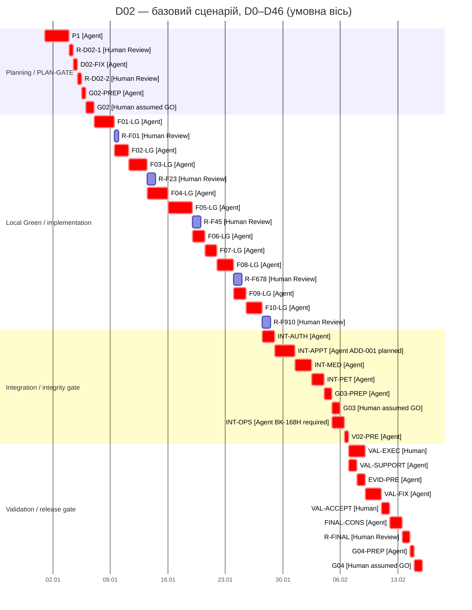

# План реалізації інформаційної системи «Ветеринарна клініка»

## 1. Статус документа

Пакет D02 підготовлено, технічно перевірено та передано на фінальний Human Review. Human approval D02 і рішення G02: GO / REVISE ще не зафіксовані.

Майбутнє затвердження D02 не означатиме автоматичного рішення G02: GO. Рішення G02, G03 і G04 приймає лише Human у відповідних Gate.

Workflow тікетів:

`Todo → In Progress → Review → Done`

Результат виконання переходить у Review. Human приймає його або повертає на доопрацювання.

## 2. Scope і нормативна основа

План охоплює погоджені 25 тікетів:

- S01, A01, G01;
- T01–T04;
- F01–F10;
- D01–D02;
- V01–V02;
- VAL01;
- G02–G04.

Нормативна основа:

- затверджена SRS v0.1;
- затверджений ADD-001;
- чинні REQ, AC і BDD без зміни їхніх ID або змісту;
- OPEN-003 та OPEN-006;
- DEP-001–005;
- повні актуальні описи GitHub Issues #1–#25;
- критерії етапу планування реалізації щодо плану, Gantt, критичного шляху, людських дій і ризиків;
- `docs/planning/traceability.md` із цього самого підготовленого пакета планових документів у робочому дереві, базованому на HEAD `10e051b0bc945a56e69a16b5539860d1014c13a6`.

Повна матриця REQ → AC → BDD → Ticket ID міститься в `docs/planning/traceability.md` і тут не дублюється.

План не вводить нових функцій. Методики тестування та verification позначаються окремо і не трактуються як нові вимоги до поведінки системи.

## 3. Ресурсна модель

Для базового розрахункового сценарію прийнято:

- один Agent;
- Agent одночасно виконує лише одну активну Agent-роботу;
- умовна місткість Agent — до 6 годин на відносний робочий день;
- окремий Human resource;
- умовна місткість Human — до 3 годин на відносний робочий день;
- людські трудовитрати подаються в годинах;
- календарні дати й фактична персональна доступність не визначаються;
- локальний Green може розблокувати наступну роботу до повного Done попереднього Issue;
- Human Review, G02, G03, VAL01 і G04 є окремими роботами;
- базовий сценарій припускає своєчасну готовність DEP-001–005;
- базовий сценарій припускає умовні рішення GO у G02, G03 і G04;
- ці рішення використовуються лише для розрахунку наступної гілки;
- фактичні Human Gate decisions ще не прийняті;
- за фактичного REVISE графік підлягає перерахунку;
- додаткові цикли виправлень після REVISE не включено до фіксованої тривалості.

Один розрахунковий день є одиницею сценарію. Він не є твердженням про фактичну доступність студента.

## 4. Поетапний план реалізації

| Етап | Основні Ticket ID | Результат / milestone |
|---|---|---|
| Planning | D02, планова частина V02, D01 | Пакет D02 і матрицю з Ticket ID підготовлено до фінального Human Review; Human approval є умовою завершення етапу |
| PLAN-GATE | G02 | Human decision; базовий сценарій продовжується лише за умовного G02: GO |
| Access | T01, F01, F02 | Локально перевірені authentication, sessions, client/staff access |
| Profiles / pets | T02, F03, F07 | Картки, пропозиції змін, стани тварини та їхні наслідки |
| Appointments / medical history | T03, T04, F04, F05 | Бронювання, статуси, медичні записи, версії та вкладення |
| Recommendations / statuses | T02, T03, T04, F06, F08 | Рекомендації, ADD-001, результати прийому та контрольовані виправлення |
| Operations / UI | F09, F10, V01 | Backup/restore, SMS/email, платформи, UI та performance evidence |
| Integrity Gate | G03 | Human decision за пакетом INT-AUTH/INT-PET/INT-APPT/INT-MED |
| Validation | VAL01 | Human acceptance погоджених клінічних потоків |
| Final evidence | V01, V02, D01 | Завершені протоколи, traceability audit і процесні докази |
| RELEASE-GATE | G04 | Human release decision; умовний GO використано лише в базовому сценарії |

## 5. Принцип залежностей

### 5.1. Blocks start / prerequisites

Передумови початку визначають мінімальний перевірений результат, без якого роботу не можна змістовно розпочати.

Повне Done попереднього Issue не вимагається, якщо наступну роботу розблоковує:

- погоджений інтерфейс;
- локальний Green потрібного механізму;
- завершений проміжний Review;
- відповідне рішення DEP;
- умовне рішення Gate: GO базового сценарію.

### 5.2. Required for closure / integration verification

Ці залежності потрібні для інтеграційної перевірки, остаточного Review або переведення Issue у Done. Вони не блокують початок, якщо їх відсутність не заважає підготувати Red, реалізацію або локальний Green.

Таке розділення запобігає циклу, у якому F03–F08 взаємно очікують Done.

## 6. Передумови початку й остаточного закриття

| Тікет | Blocks start / prerequisites | Required for closure / integration verification |
|---|---|---|
| T01 | S01; тести й Red можна готувати до завершення F01–F02 | Green F01–F02; інтеграція з F05/F07; реальна SMS-перевірка V01; докази D01 |
| T02 | S01; Red не очікує завершення F03/F07 | Green F03/F07; наскрізні наслідки F04–F06/F08; D01 |
| T03 | S01, A01; Red не очікує завершення F04/F06/F08 | Green F04/F06/F08; F01/F05/F07; чотири сценарії ADD-001; D01 |
| T04 | S01; Red не очікує завершення F05 | Green F05; інтеграція F01–F02/F04/F06/F08; D01 |
| F01 | S01; G02: GO; релевантний Red T01; DEP-005 | Green T01; медичний доступ F05/T04; V01; D01 |
| F02 | G02: GO; механізми доступу й сеансів F01; Red T01 | Green T01; F01/F07; D01; DEP-002 для реальної SMS-перевірки; DEP-004 для реального особистого відновлення |
| F03 | G02: GO; механізми ролей F01 і профілю F02; Red T02 | Green T02; інтеграція F04/F05/F07/F08; D01 |
| F04 | G02: GO; механізми F01 і ідентифікація тварини F03; Red T03 | Green T03; інтеграція F05–F08; D01 |
| F05 | G02: GO; механізми F01, картка F03 і зв’язок із прийомом F04; Red T04 | Green T04; розмежування з F06; статуси F08; V01; D01 |
| F06 | G02: GO; A01; інтерфейси F04/F05; Red T03 | Green T03, включно з ADD-001; інтеграція F04/F05/F07/F08; D01 |
| F07 | G02: GO; інтерфейси F03/F04/F06; Red T02 | Green T02; наслідки з F03/F04/F06; історична хронологія F08/T03; D01 |
| F08 | G02: GO; інтерфейси F01/F04/F05/F06/F07; Red T03 | Green T03; F03–F07; цілісність опису T04; D01 |
| F09 | S01; G02: GO; DEP-002–003 для відповідного налаштування; Red | Результати F03/F05; V01; D01; придатні копії за REQ-NF-007–009 |
| F10 | G02: GO; потрібні потоки F01–F08 для конкретної частини; Red | Інтегровані потоки; DEP-001; V01; D01 |
| V01 | S01/A01 для підготовки; для прогону — відповідна поведінка, тести та релевантні DEP-001–003/005 | Повні протоколи, повторні перевірки після виправлень; передавання доказів feature-тікетам і G03 |
| V02 | Для планової частини — S01/A01/D02 draft; для завершальної — результати й журнали | Планова матриця з Ticket ID; завершальний аудит D01, тестів і verification |
| VAL01 | G03: GO; готові результати погодженого обсягу T01–T04 і V01/V02 | Усунення зауважень, повторні перевірки й явне Human acceptance |
| G04 | G03: GO; VAL01 accepted; завершені V01, V02, D01; актуальні DEP/OPEN | Пакет без блокерів і Human: GO |

У таблиці Gate dependencies описують реальну логіку виконання. У Gantt рішення GO використано лише як припущення базового сценарію.

## 7. Локальні Green та проміжні Review

Локальний Green означає, що відповідна реалізація проходить релевантні автоматизовані тести у своєму поточному контексті. Він може надати механізм наступній роботі, але не означає повне інтеграційне закриття Issue.

Проміжні Review:

- R-F01 — механізми доступу й сеансів;
- R-F23 — клієнтський доступ і картки;
- R-F45 — бронювання та медична історія;
- R-F678 — рекомендації, стани тварини й результати прийому;
- R-F910 — резервування, інтерфейс і нефункціональні роботи;
- R-FINAL — завершений пакет V01/V02/D01 після validation.

Проміжні Review не мають непідтвердженого числового slack. Їх перенесення допускається лише після повторної перевірки зайнятості Human, залежностей і впливу на Agent sequence.

## 8. Інтеграційні роботи

| Робота | Зміст | Передумови | Результат |
|---|---|---|---|
| INT-AUTH | Клієнтський і робочий доступ, сеанси, серверні права, прямі запити та SMS-стани | R-F01, R-F23, R-F678; DEP-005; DEP-002 для реального SMS | Security/access evidence для G03 і V01 |
| INT-PET | Картки, пропозиції змін, смерть, припинення опіки та їхні наслідки | R-F23, R-F45, R-F678 | Докази T02/T03 щодо критичних станів |
| INT-APPT | Розклад, конкурентне бронювання, статуси, рекомендації та зв’язок із записом; запланований основний прогін чотирьох сценаріїв ADD-001 | R-F01, R-F45, R-F678; доступні результати F05/F06 | Докази T03, REQ-F-067–072 і ADD-001 для G03 |
| INT-MED | Медичний доступ, авторство, версії, вкладення, процедури й опис проведеного прийому | R-F01, R-F23, R-F45, R-F678 | Заплановані докази T04; надалі використовуватиме ADD-001 evidence з INT-APPT без повторного прогону |
| INT-OPS | Платформи, performance, SMS/email, backup і restore | R-F23, R-F45, R-F910; DEP-001–003; `BK-168H` | Експлуатаційні протоколи V01 |

Методики інтеграційної перевірки:

- керований час — test technique для REQ-NF-003;
- дійсно одночасні запити — test technique для AC-F-041;
- прямі запити та підстановка ID — verification technique для REQ-NF-015;
- моделювання відмов SMS, email і backup — verification technique;
- вимірювальний стенд і профіль навантаження — DEP-001;
- пробне відновлення в окремому середовищі — AC-NF-009.

## 9. DEP-001–005

| DEP | Потрібне рішення | Контрольна точка |
|---|---|---|
| DEP-001 | Сервер, сховище, мережа, точні ОС/браузери, екрани, тривалість і профіль навантаження, кількість спроб | До відповідних прогонів F10, INT-OPS і V01 |
| DEP-002 | SMS-provider, технічна пошта, контрольний номер, адреса відповідальної особи, credentials | До реальної SMS/email integration verification |
| DEP-003 | Hosting, окреме розміщення backup, виявлення збоїв, відповідальна технічна особа, інструкція відновлення | До F09/INT-OPS і експлуатаційного приймання |
| DEP-004 | Достатність доказів особи при особистому відновленні | До реального використання REQ-F-009 |
| DEP-005 | Алгоритм і параметри хешування, secret storage, HTTPS configuration | До F01, INT-AUTH і відповідного security-прогону V01 |

Невідома затримка DEP не замінюється вигаданою оцінкою. Якщо DEP не готова, відповідна залежна робота зміщується на фактичний строк очікування.

## 10. Календарна умова backup

REQ-NF-008 задає сім календарних діб зберігання. У плані використовується контрольна точка:

`BK-168H = минуло щонайменше 168 годин від початку придатної серії резервних копій, а докази підтверджують наявність придатних копій за весь погоджений семиденний період.`

Умови:

- 168 годин є календарним часом;
- 7 робочих днів не прирівнюються автоматично до 7 календарних діб;
- накопичення не потребує безперервної роботи Agent;
- INT-OPS не починає остаточну перевірку REQ-NF-008 до `BK-168H`;
- у базовому сценарії `BK-168H` має бути досягнуто не пізніше моменту початку INT-OPS у відносний день 35;
- без календаря неможливо визначити точний відносний день досягнення `BK-168H`;
- невиконання цієї умови зсуває INT-OPS, V02-PRE, VAL01, фінальну консолідацію і G04 на фактичний строк очікування.

## 11. Базовий Gantt

Інтервали подано як `[початок; кінець)`. Правий край роботи локального Green або Human decision window є відповідною контрольною точкою.

| ID роботи | Ресурс | Початок | Кінець | Тривалість / effort | Залежності або результат |
|---|---|---:|---:|---:|---|
| P1 | Agent | 0 | 3 | 18 год | Первинний D02 |
| R-D02-1 | Human | 3 | 3,5 | 1,5 год | Review первинного D02 |
| D02-FIX | Agent | 3,5 | 4 | 3 год | Виправлений D02 |
| R-D02-2 | Human | 4 | 4,5 | 1,5 год | Фінальний Human Review виправленого D02 |
| G02-PREP | Agent | 4,5 | 5 | 3 год | Лише після Human approval D02; планова частина V02 |
| G02 | Human | 5 | 6 | 3 год | Вікно Human-рішення; умовний G02 GO лише в базовому сценарії |
| F01-LG | Agent | 6 | 8,5 | 15 год | Локальний Green F01 |
| R-F01 | Human | 8,5 | 9 | 1,5 год | Review механізмів доступу |
| F02-LG | Agent | 8,5 | 10,25 | 10,5 год | Механізми F01 доступні |
| F03-LG | Agent | 10,25 | 12,5 | 13,5 год | F01/F02 mechanisms |
| R-F23 | Human | 12,5 | 13,5 | 3 год | Review F02/F03 |
| F04-LG | Agent | 12,5 | 15 | 15 год | F03 mechanisms |
| F05-LG | Agent | 15 | 18 | 18 год | F01/F03/F04 mechanisms |
| R-F45 | Human | 18 | 19 | 3 год | Review F04/F05 |
| F06-LG | Agent | 18 | 19,5 | 9 год | A01; F04/F05 interfaces |
| F07-LG | Agent | 19,5 | 21 | 9 год | F03/F04/F06 interfaces |
| F08-LG | Agent | 21 | 23 | 12 год | F01/F04–F07 interfaces |
| R-F678 | Human | 23 | 24 | 3 год | Review F06–F08 |
| F09-LG | Agent | 23 | 24,5 | 9 год | DEP-002–003 |
| F10-LG | Agent | 24,5 | 26,5 | 12 год | Доступні основні потоки |
| R-F910 | Human | 26,5 | 27,5 | 3 год | Review F09/F10 |
| INT-AUTH | Agent | 26,5 | 28 | 9 год | R-F01, R-F23, R-F678; DEP-005 |
| INT-APPT | Agent | 28 | 30,5 | 15 год | R-F01, R-F45, R-F678; запланований основний прогін чотирьох сценаріїв ADD-001 |
| INT-MED | Agent | 30,5 | 32,5 | 12 год | R-F01, R-F23, R-F45, R-F678; надалі використовуватиме ADD-001 evidence з INT-APPT |
| INT-PET | Agent | 32,5 | 34 | 9 год | R-F23, R-F45, R-F678 |
| G03-PREP | Agent | 34 | 35 | 6 год | INT-AUTH, INT-PET, INT-APPT, INT-MED; пакет T01–T04/V01/D01 |
| G03 | Human | 35 | 36 | 3 год | Вікно Human-рішення; умовний G03 GO лише в базовому сценарії |
| INT-OPS | Agent | 35 | 36,5 | 9 год | R-F23, R-F45, R-F910; DEP-001–003; `BK-168H` |
| V02-PRE | Agent | 36,5 | 37 | 3 год | Умовний G03 GO; завершені всі INT-роботи |
| VAL-EXEC | Human | 37 | 39 | 6 год | Заплановане Human виконання validation-сценаріїв |
| VAL-SUPPORT | Agent | 37 | 38 | 6 год | Технічна підтримка validation |
| EVID-PRE | Agent | 38 | 39 | 6 год | Підготовка зауважень і доказів |
| VAL-FIX | Agent | 39 | 41 | 12 год | Завершені VAL-EXEC і гілка VAL-SUPPORT → EVID-PRE |
| VAL-ACCEPT | Human | 41 | 42 | 3 год | Заплановане Human acceptance VAL01 |
| FINAL-CONS | Agent | 42 | 43,5 | 9 год | Фінальні V01/V02/D01 |
| R-FINAL | Human | 43,5 | 44,5 | 3 год | Review фінальних протоколів |
| G04-PREP | Agent | 44,5 | 45 | 3 год | Release package |
| G04 | Human | 45 | 46 | 3 год | Вікно Human-рішення; умовний G04 GO лише в базовому сценарії |

Календарна контрольна точка `BK-168H` не має Agent effort і не має визначеного відносного дня без календарної прив’язки. Для чинності таблиці вона повинна настати до моменту початку INT-OPS.

### 11.1. Графічна діаграма Ганта

Mermaid Gantt потребує календарної осі, тому нижче використано **умовну** дату відліку `2000-01-01 00:00 = D0`. Одна календарна доба на цій осі дорівнює одному відносному робочому дню моделі; `D0,25 = +6 год`, `D0,5 = +12 год`, `D0,75 = +18 год`. Ці позначки не є реальними календарними датами й не описують фактичну доступність Agent або Human. Тривалості в діаграмі показують інтервали розкладу, а трудовитрати залишаються в числовій таблиці.

Правий край кожної роботи `Fxx-LG` є milestone локального Green. Праві краї G02, G03, VAL-ACCEPT і G04 є контрольними точками відповідного Human-рішення; `assumed GO` — лише припущення базового сценарію. Позначка `crit` показує resource-constrained sequence цього конкретного розкладу й не є доказом математичної оптимальності. Паралельність явно показана для Review/наступної Agent-роботи, G03/INT-OPS і гілок `VAL-EXEC` та `VAL-SUPPORT → EVID-PRE`.

## 12. Перекриття робіт

Обґрунтоване перекриття становить 7,5 розрахункового дня:

- 4,5 дня: проміжні Human Review виконуються паралельно з наступною Agent-роботою, коли потрібний механізм уже доступний;
- 1 день: G03 виконується Human паралельно з INT-OPS Agent;
- 2 дні: VAL-EXEC Human перекривається з VAL-SUPPORT та EVID-PRE Agent.

У межах одного ресурсу перекриття немає.

## 13. Трудовитрати

### Agent

- планування та підготовка Gate: 24 год;
- локальна реалізація F01–F10: 123 год;
- INT-AUTH/INT-PET/INT-APPT/INT-MED/INT-OPS: 54 год;
- G03-PREP: 6 год;
- V02-PRE: 3 год;
- validation support, evidence і fixes: 24 год;
- фінальна консолідація й G04-PREP: 12 год.

Разом: **246 год**, або **41 розрахунковий Agent-day**.

### Human

- Review і затвердження D02: 3 год;
- G02: 3 год;
- проміжні Review: 13,5 год;
- G03: 3 год;
- VAL01 execution та acceptance: 9 год;
- фінальний Review: 3 год;
- G04: 3 год.

Разом: **37,5 год**, або **12,5 розрахункового Human-day**.

Послідовна сума ресурсних робіт без перекриття:

`41 + 12,5 = 53,5 дня`.

Тривалість обраного розкладу:

`53,5 − 7,5 = 46 відносних робочих днів`.

## 14. G03

До завершальної підготовки пакета G03 мають бути готові:

- INT-AUTH;
- INT-PET;
- INT-APPT, включно із запланованим основним прогоном чотирьох сценаріїв ADD-001;
- INT-MED, який надалі використовуватиме результати ADD-001 без повторного прогону;
- релевантні результати T01–T04;
- доступні протоколи V01 і записи D01;
- докази критичних наслідків станів і статусів за REQ-F-030–033 та REQ-F-046–050;
- докази наслідків рекомендацій за REQ-F-066–072.

Повний статус V01: Done і D01: Done до початку G03 не вимагається. Потрібні саме готові релевантні докази.

Ці критерії є плановими критеріями майбутнього Gate. Рішення G03 у Gantt є умовним GO базового сценарію. Фактичне GO / REVISE приймає Human.

Актуальний Issue #24 формально відображає ці критерії; їхню узгодженість із матрицею повторно перевіряє планова частина V02.

## 15. Resource-constrained sequence

Resource-constrained sequence базового сценарію:

`D02 → Human approval D02 → G02-PREP → умовний G02 GO → Agent sequence F01–F10 → INT-AUTH → INT-APPT → INT-MED → INT-PET → G03-PREP → паралельні G03 Human та INT-OPS Agent → V02-PRE`.

Після V02-PRE виконуються дві паралельні гілки:

- Human: `VAL-EXEC`;
- Agent: `VAL-SUPPORT → EVID-PRE`.

Обидві гілки мають завершитися до початку VAL-FIX.

Подальша послідовність:

`VAL-FIX → VAL-ACCEPT → FINAL-CONS → R-FINAL → G04-PREP → умовний G04 GO`.

Це resource-constrained critical sequence для наведеного розкладу. Вона не оголошується математично мінімальною для всіх можливих розкладів.

Числовий slack проміжних Review не фіксується: перенесення Review може спричинити конфлікт Human resource або заблокувати INT-роботу. Проміжок у таблиці не вважається допустимим резервом без повторного ресурсного розрахунку.

## 16. Умови чинності строку

Строк 46 відносних робочих днів чинний за таких умов:

1. DEP-001–005 готові до відповідних залежних робіт.
2. `BK-168H` досягнуто до INT-OPS.
3. Один Agent не має двох одночасних активних робіт.
4. Human може виконати зазначені Review, Gate і validation у відведених інтервалах моделі.
5. G02, G03 і G04 отримують фактичний GO у показаних контрольних точках.
6. VAL01 завершується acceptance після запланованого циклу виправлень.
7. Не виникають додаткові зміни baseline або функціональності.
8. Немає невідомих зовнішніх затримок інтеграцій.

Порушення будь-якої умови потребує повторного розрахунку Gantt. Невідомі затримки не підміняються вигаданими оцінками.
